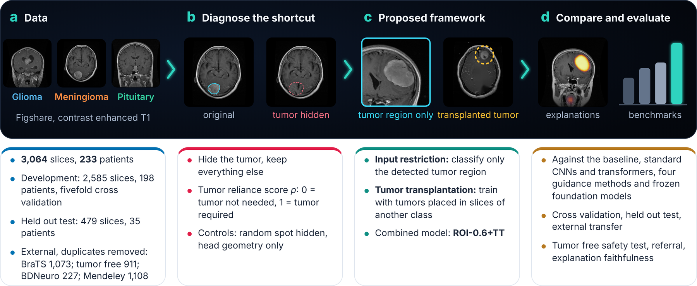
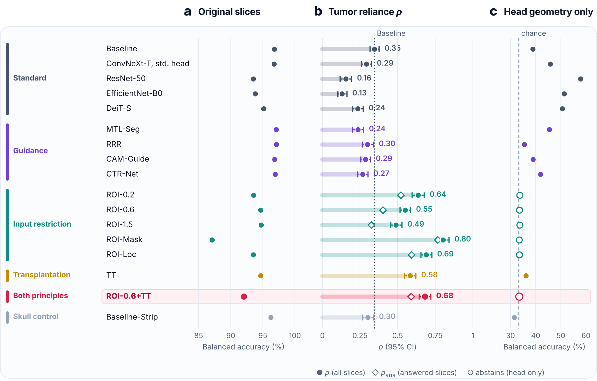
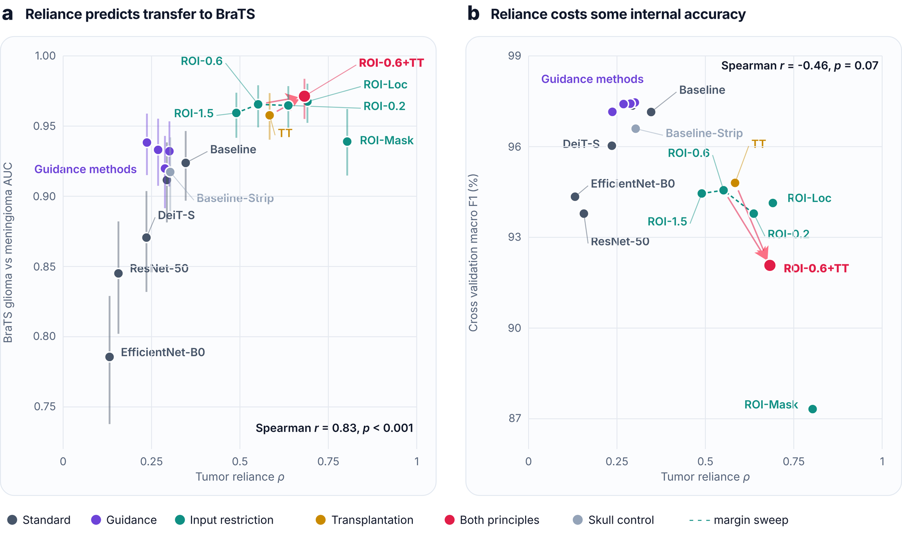
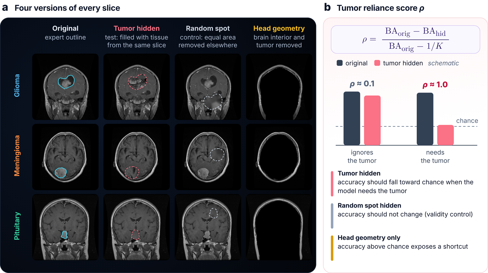
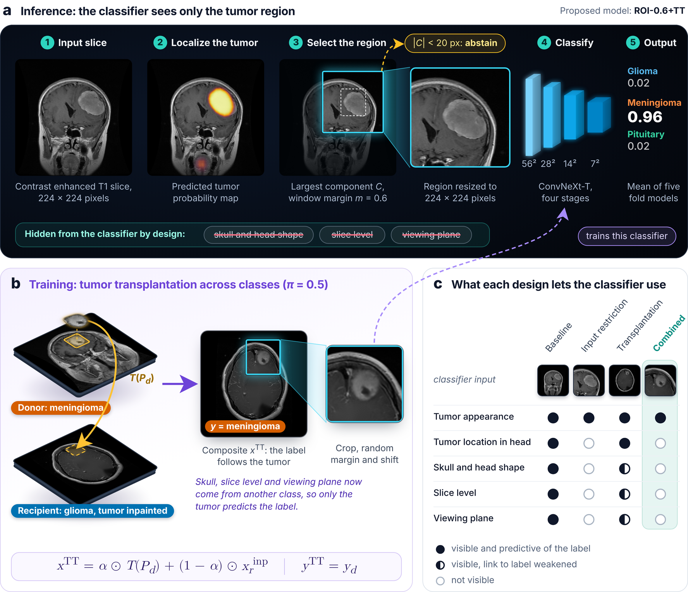

# Does your brain tumor classifier look at the tumor?

**Reducing tumor independent shortcut learning in brain tumor MRI classification: input restriction and tumor transplantation with external validation**

Farhan Shahriar, Raufu Umme Rhidi, Ferdaus Anam Jibon\*, Obaidul Haque
Department of Computer Science and Engineering, International University of Business Agriculture and Technology (IUBAT), Dhaka, Bangladesh
\*Corresponding author: jibon.cse@iubat.edu · Manuscript submitted to *Journal of Neuroscience Methods* (2026)

[](LICENSE)
[](#citation)

---

## In one paragraph

Deep networks reach 94% to 98% accuracy on the widely used Figshare brain tumor MRI dataset. This repository shows that much of that accuracy does **not** come from the tumor. Replacing the tumor with healthy tissue left a ConvNeXt baseline with two thirds of its above chance accuracy, and the head outline alone gave standard networks up to 58% balanced accuracy (chance 33%). Four established "attend to the tumor" methods made this dependence **worse**. Two simple principles, **input restriction** (classify only a window around the segmented tumor) and **tumor transplantation** (train on slices that carry a tumor of another class), reduced it and improved transfer to independently acquired BraTS data. Across 17 models, a single number measured on the development data, the **tumor reliance score**, predicted external performance (Spearman r = 0.83).



## Key findings

| Finding | Evidence |
|---|---|
| High accuracy hides a shortcut | Baseline tumor reliance ρ = 0.35: about two thirds of above chance accuracy survives hiding the tumor |
| The head outline alone is informative | Up to 58% balanced accuracy from scalp, skull and slice position (chance 33%) |
| Attention guidance does not fix it | MTL-Seg, RRR, CAM-Guide and CTR-Net all **lowered** ρ (0.24 to 0.30) |
| Tumor transplantation works without any locator | ρ 0.35 → 0.58, BraTS AUC 0.924 → 0.958 |
| Input restriction improves transfer and safety | BraTS AUC up to 0.971; confident answers on tumor free slices 56% → below 2% |
| Reliance predicts transfer | Spearman r = 0.83 across 17 models (0.81 excluding abstentions) |
| Honest costs | 2 to 5 points of cross validation macro F1; part of the input restriction effect comes from abstaining when no tumor is found (reported as ρ_ans) |





## The tumor reliance test

Hide the tumor with tissue from elsewhere in the same slice, keep everything else, and measure how much balanced accuracy is lost:

ρ = clip₀,₁ ( (BA_orig − BA_hidden) / (BA_orig − 1/K) )

ρ = 1: the model is at chance without the tumor. ρ = 0: hiding the tumor changes nothing. Two controls guard against artifacts: hiding a random tumor sized spot (accuracy must not change) and a head geometry only version (accuracy above chance reveals a shortcut).



## The two principles



* **Input restriction (ROI-m):** a segmentation network finds the tumor; the classifier sees only a square window with context margin m (0.2, 0.6 or 1.5). Abstains when no tumor is found.
* **Tumor transplantation (TT):** during training, the tumor of a donor slice is moved into a slice of another class whose own tumor was removed; the label follows the tumor, so skull, slice level and plane become uninformative.

## Repository structure

| Folder | Content |
|---|---|
| `notebooks/01_run6_training_and_evaluation.ipynb` | Main Kaggle notebook: data preparation, duplicate audit, training (5 folds), reliance test, external evaluation, safety and explanation analyses |
| `notebooks/01a_*`, `01b_*` | The same notebook as executed for the paper, with all outputs |
| `notebooks/02_figure_assets.ipynb` | Exports the real images, maps and crops used in Figs. 2 and 3 |
| `notebooks/03_results_export.ipynb` | Exports saved predictions and computes the LayerCAM maps of Fig. 7 |
| `src/` | Python source of the main notebook |
| `data_prep/` | BraTS 2023 tumor and tumor free slice extraction |
| `data/` | Patient level split, BraTS slice lists, full near duplicate audit, lists of evaluated external images |
| `results/predictions/` | Saved outputs of the 17 models: test and external predictions, out of fold logits, run records, reliance outputs, attribution maps |
| `results/run6_tables/`, `results/*.csv` | Tables printed by the notebook and statistics recomputed for the paper |
| `analysis/` | Scripts that recompute every number of Tables 3 to 5 and Section 3 |
| `figures/` | Scripts for Figs. 1 to 7 |

## Reproduce every number in the paper (CPU only, a few minutes)

```bash
pip install numpy pandas scipy scikit-learn
python analysis/analysis.py            # results/main.csv, comparisons.csv, reliance.csv, ...
cd analysis && python abst.py && python aurc.py && cd ..
python analysis/make_tables.py         # results/tables_3_to_5.md
```

The recomputed `results/main.csv` is identical to the one used for the manuscript.

## Data (not redistributed)

| Dataset | Role |
|---|---|
| Figshare brain tumor dataset (Cheng, 2017), 3,064 slices, 233 patients | Development (5 patient level folds) and held out test (35 patients) |
| BraTS 2023 adult glioma and meningioma | External test (1,073 slices, 368 patients) and 911 tumor free slices |
| BDNeuro-MRI v8 and Mendeley v1 (Hira et al.) | External test after near duplicate screening (227 and 1,108 images) |
| BRISC (Fateh et al., 2026) | Duplicate audit and explanation analysis |
| Kaggle brain tumor MRI v2 (Nickparvar, 2021) | Duplicate audit only |

Links and file descriptions: [`data/README_data.md`](data/README_data.md). Public collections redistribute the same images heavily (47% to 100% of images, depending on collection and class, were near duplicates of Figshare); only images without a near duplicate were evaluated.

## Model names: code vs paper

| Code | Paper | Code | Paper |
|---|---|---|---|
| CNX-Plain | Baseline | ROI-Crop | ROI-0.2 |
| ConvNeXt-Tiny | ConvNeXt-T (standard head) | ROI-Crop-m06 | ROI-0.6 |
| ResNet-50 | ResNet-50 | ROI-Crop-m15 | ROI-1.5 |
| EfficientNet-B0 | EfficientNet-B0 | ROI-Mask | ROI-Mask |
| DeiT-Small | DeiT-S | ROI-Loc | ROI-Loc |
| MTL-Seg | MTL-Seg | CNX-Transplant | TT |
| RRR | RRR | ROI-m06-Transplant | ROI-0.6+TT |
| CAM-Guide | CAM-Guide | CNX-Strip | Baseline-Strip |
| CTR-Net | CTR-Net | | |

The main notebook also trains exploratory models that are not part of the paper; their outputs are not included.

## Reproducibility notes

* Kaggle, one NVIDIA T4 GPU per run, PyTorch 2.11, timm 1.0.29; seeds fixed in the notebook; 155 training runs.
* The Mendeley collection was reduced with a perceptual hashing script before screening; that script was not preserved. `data/evaluated_images_mendeley.csv` lists the 1,108 evaluated images, so the subset can be rebuilt exactly.
* Trained weights (155 runs, about 110 MB each) are available from the corresponding author on reasonable request.

## Citation

```bibtex
@misc{shahriar2026reducing,
  title  = {Reducing tumor independent shortcut learning in brain tumor MRI classification:
            input restriction and tumor transplantation with external validation},
  author = {Shahriar, Farhan and Rhidi, Raufu Umme and Jibon, Ferdaus Anam and Haque, Obaidul},
  year   = {2026},
  note   = {Manuscript submitted to Journal of Neuroscience Methods. Code: https://github.com/Farhan191091/Reducing-tumor-independent-shortcut-learning-in-brain-tumor-}
}
```

## License

Code: MIT. Files in `data/` and `results/` are derived from public datasets and are shared for research use under the terms of the original datasets.
